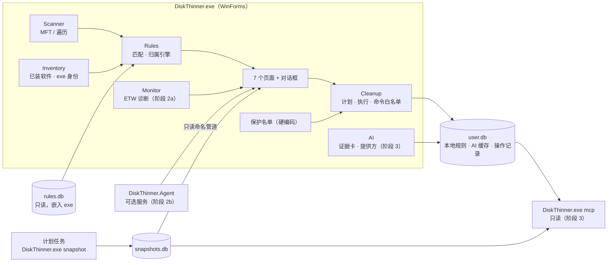

# DiskThinner 研发方案与实施步骤（v0.2）

日期：2026-10-20
依据：HTML 原型 v0.2（`prototype/index.html`）、《架构与规则库设计 v0.1》、10-19 的方案讨论

## 0. 本版结论

相对 v0.1 设计草案的变化：

- 归属以确定性证据为主：扫描、快照、ETW、文件占用、exe 签名、已装软件。规则只回答"是什么类别、风险多大"，AI 只兜底未识别目录。
- 规则库第一阶段只做内置规则：YAML 源文件编译成 SQLite，嵌入 exe。远程更新、签名链、第三方源推到阶段 4，设计沿用 v0.1 第 3、5 节（分发格式改为 SQLite 全量更新）。
- 不设隔离区：直接删除、运行官方命令，或者打开所在位置让用户自己清理。"无法恢复"和"AI 建议"两类走严格确认，操作记录只追加不修改。
- 增长对比：快照按大小剪枝存储，展示用"热点分解"算法（3.5 节），代替上次提的"70% 下钻"。
- 界面：.NET 10 WinForms，第一版只做浅色主题；空间浏览保持三栏联动；来源标签四种（实测 / 规则 / 推断 / AI 推断）；AI 给出的风险最低只能是"需重新下载"。

## 1. 目标与边界

### 1.1 v1.0 要回答的四个问题

| 问题 | 手段 | 阶段 |
|---|---|---|
| 哪里大 | MFT 扫描，失败时退回目录遍历 | 1 |
| 哪里在涨 | 每日快照 + 对比 + 热点分解 | 1 |
| 是谁的 | 已装软件匹配、exe 签名、文件占用、ETW 写入进程 | 1（ETW 在 2） |
| 能不能删、怎么删 | 通用规则 + 重点规则 + 保护名单 + 清理执行器，AI 兜底 | 1（AI 在 3） |

### 1.2 不做的事

- 不清理浏览器历史、Cookie 这类隐私数据，不做注册表清理。
- WinSxS、系统还原点、pagefile、hiberfil 不直接删，只引导到 DISM、系统设置等官方入口。
- 不做实时防护和开机常驻（阶段 2 的服务是用户主动开启的可选项）。
- 第一版不做暗色模式和英文界面。字符串从一开始就放进 resx，以后补。

### 1.3 性能目标（目标值，阶段 0 实测后修正）

| 指标 | 目标 |
|---|---|
| MFT 扫描约 130 万文件 | ≤ 10 秒 |
| 普通权限遍历扫描 | 可用，有进度，可取消 |
| 扫描完成后的内存 | ≤ 300 MB（130 万节点） |
| 冷启动到窗口显示 | ≤ 1 秒 |
| 全树规则匹配 | ≤ 1 秒 |
| 单次快照体积 | ≤ 1 MB |
| 依赖运行库版 exe 体积 | ≤ 10 MB |

## 2. 总体架构



### 2.1 进程与权限

| 进程 | 形态 | 权限 | 说明 |
|---|---|---|---|
| DiskThinner.exe | WinForms，JIT，依赖 .NET 10 桌面运行库（另出单文件自包含版） | 默认普通权限启动；界面提供"以管理员身份重启" | 管理员时启用 MFT 扫描、系统目录清理、ETW 诊断 |
| `DiskThinner.exe snapshot` | 同一个 exe 的无界面子命令 | 由计划任务调用，可选"使用最高权限" | 每日快照 |
| `DiskThinner.exe mcp` | 同一个 exe 的 stdio 子命令 | 普通权限 | 阶段 3。WinExe 能否正常走 stdio 要在阶段 3 开头验证，不行就拆成单独的控制台 exe |
| DiskThinner.Agent | Windows 服务，Native AOT | SYSTEM | 阶段 2b，可选安装。只监控和写自己的库，不联网、不删除 |

### 2.2 解决方案结构

```
DiskThinner.sln
Directory.Build.props        Nullable、警告即错误、类库开启 IsAotCompatible
Directory.Packages.props     集中管理并固定依赖版本
src/
  DiskThinner.Core           领域模型、路径令牌、风险/类别枚举、来源标签、保护名单
  DiskThinner.Scanner        MFT 解析、目录遍历回退、紧凑节点树
  DiskThinner.Inventory      已装软件、exe 版本信息与签名、运行中进程
  DiskThinner.Rules          规则模型、规则库读取、匹配引擎、启发式推断、归属引擎
  DiskThinner.Storage        SQLite：snapshots.db、user.db；快照剪枝与对比
  DiskThinner.Cleanup        清理计划、执行器、官方命令白名单、Restart Manager
  DiskThinner.Monitor        ETW 诊断会话与汇总（阶段 2）
  DiskThinner.AI             证据卡、提供方客户端、技能提示词、MCP 工具（阶段 3）
  DiskThinner.App            WinForms 界面与子命令入口
  DiskThinner.Agent          可选服务（阶段 2b）
tools/
  dtrule                     规则校验、编译成 rules.db、本机 probe
rules/
  schema/rule.schema.json
  generic/*.yaml             通用结构规则
  apps/*.yaml                重点软件规则
  system/*.yaml              系统位置（多为引导类）
tests/
  DiskThinner.*.Tests        xUnit
  fixtures/                  目录树样本 + 期望结果（以后 C++ 版共用）
docs/
prototype/
```

### 2.3 工程约定

- Core、Scanner、Inventory、Rules、Storage、Cleanup 不引用 WinForms，按 AOT 要求写：不用反射，JSON 用 System.Text.Json 源生成，SQLite 手写读取不用 ORM。这样阶段 2b 的服务能直接复用，以后换 C++ 也只需对齐 fixtures。
- 第一阶段第三方依赖只有三个：Microsoft.Data.Sqlite（运行时）、YamlDotNet（只在 dtrule 里）、xUnit（只在测试里）。界面不引入第三方控件库，卡片、方块图、条形用 GDI 自绘。
- 版本号在阶段 0 锁定到 Directory.Packages.props，后续升级单独提交。
- 本地数据放在 `%LOCALAPPDATA%\DiskThinner\`：`settings.json`、`snapshots.db`、`user.db`、`rules\`、`logs\`。
- 现有的 `scan_*.csv` 和 `.kiro\scan\` 下的扫描数据体积大，而且含本机路径，加入 `.gitignore`。
- 每个阶段或里程碑完成、构建和测试全部通过后，先提交一次，再开始下一步。

## 3. 核心模块设计

### 3.1 扫描器

快速路径（需要管理员，仅 NTFS）：

1. 打开卷 `\\.\C:`，读引导扇区，得到簇大小和 `$MFT` 起始位置。
2. 读 `$MFT` 自身的数据段列表，按大块顺序读取 FILE 记录，逐条应用 fixup。
3. 解析 `$STANDARD_INFORMATION`（时间、属性）、`$FILE_NAME`（父记录号、名称，跳过 8.3 短名）、`$DATA`（逻辑大小、分配大小）、`$ATTRIBUTE_LIST`（属性放在扩展记录里的情况）。
4. 按父记录号拼成树，后序遍历一次汇总目录大小和文件数。

要专门处理的情况：硬链接（同一记录多个文件名，大小只算一次并记下链接数）、压缩和稀疏文件（分配大小小于逻辑大小）、备用数据流（计入分配大小）、重解析点（junction 和符号链接不展开）、碎片化的 `$MFT`。

回退路径：.NET 的 `FileSystemEnumerable`（底层是 `NtQueryDirectoryFile`），最多 16 个线程按目录分发，不跟随重解析点。普通权限、非 NTFS 卷、MFT 解析失败时使用。阶段 0 实测整个 C 盘约需 1.5 到 2 分钟（MFT 约 5 秒），而且有三个局限要在界面上说明：正在写入的文件大小可能偏小、硬链接重复计算、占用是估算值。详见 `docs/phase0-report.md`。

内存布局，用结构体数组代替对象树：

```csharp
// 每个节点约 48 字节；名称统一放在一个 char[] 池里
struct Node
{
    public int Parent, FirstChild, NextSibling;
    public int NameOffset; public ushort NameLength; public ushort Flags; // 目录、重解析点、硬链接、系统、隐藏…
    public long LogicalSize, AllocSize;   // 目录为整棵子树的汇总
    public long LastWriteUtc;
    public int FileCount;
    public int Tag;                       // 规则匹配结果索引，-1 表示未命中
}
```

"记录号 → 节点下标"的映射只在扫描期间存在，建完树就释放。子节点按大小降序排好，界面直接用。

### 3.2 已装软件与程序身份

| 来源 | 内容 |
|---|---|
| 注册表卸载项 | HKLM、HKCU、WOW6432Node：显示名、厂商、InstallLocation、版本 |
| 商店应用 | `%LOCALAPPDATA%\Packages\<包族名>` 与已注册包列表对应 |
| npm 全局包 | `%APPDATA%\npm\node_modules` |
| scoop | `~\scoop\apps` |
| PATH 和 `~\.local\bin` | 命令行工具（uv、claude 等） |
| 运行中进程 | 映像路径、命令行、父进程 |

exe 身份用 `FileVersionInfo`（公司名、产品名）加 Authenticode 签名者（`WinVerifyTrust` 校验后取签名证书主题）。中文软件的目录名和显示名经常对不上（"微信" 对 `Tencent\WeChat`），用 InstallLocation 和 exe 里的英文产品名做关联。

### 3.3 规则与归属引擎

规则流转：`rules/*.yaml` 经 `dtrule validate` 和 `dtrule build` 编译成 `rules.db`，作为资源嵌入 exe。首次运行释放到 `%LOCALAPPDATA%\DiskThinner\rules\rules-<hash>.db`，以只读、不可修改方式打开。

表结构沿用 10-19 讨论的 SQLite 草案：`meta`、`apps`、`detect`、`processes`、`locations`、`actions`、`texts`、`evidence`，`tested_on` 改为可选。路径令牌用 Known Folder API 解析，不依赖环境变量，因为 Documents 可能被重定向到 D 盘或 OneDrive。

匹配：启动时把 locations 展开成路径前缀树，加上结构规则的谓词（目录名、同级特征、扩展名分布）。扫描完成后整棵树遍历一次打标签。

归属引擎对每个节点输出：

```csharp
record Attribution(
    string? Owner,            // 归属应用
    Category Category,        // 缓存、临时、日志、转储、包缓存、会话记录、用户数据、配置、凭据…
    Risk Risk,                // 安全 / 需重新下载 / 丢失历史或登录态 / 丢失用户数据 / 禁止
    Source Source,            // 实测 / 规则 / 推断 / AI 推断
    Confidence Confidence,
    IReadOnlyList<Evidence> Evidence);
```

合并原则：归属以实测证据优先（ETW、文件占用），类别和风险以规则优先；多条证据给出的风险不同时取最保守的那个；保护名单的结论任何来源都覆盖不了。

第一批规则数量由阶段 0 的覆盖率实验决定，预计：通用结构规则 30 到 50 条，开发和 AI 工具 30 到 50 条，系统位置约 20 条（大多是引导类）。

### 3.4 保护名单

硬编码在 Core 里，用户只能追加，不能删除。执行清理前再校验一次。

- 凭据：`.ssh`、`.gnupg`、`.aws\credentials`、`.azure`、`.kube\config`、`.docker\config.json`、`.git-credentials`、`.claude\.credentials.json`、`.codex\auth.json` 等。
- 浏览器的 Login Data、Cookies、Local State。加密货币钱包文件。
- 软保护区：Documents、Desktop、Pictures、Downloads。只有已实测的内置规则能在这里提出建议，而且必须逐项确认。
- `%WINDIR%` 下除白名单以外的目录。白名单包括 Temp、LiveKernelReports、Minidump、ServiceProfiles 下的 Temp、Temporary ASP.NET Files 等。
- Program Files 下的程序文件。
- pagefile、hiberfil、swapfile、System Volume Information、WinSxS：只给引导，不删。

### 3.5 快照与增长分析

存储时剪枝：

- 只记录 50 MB 以上的目录和 100 MB 以上的文件。父目录不小于子目录，所以剪枝后仍是一棵连通的树。
- 深度上限 32 层，更深的并入上级。
- 上次记录过、这次低于阈值的节点再记一次，"从 2 GB 降到 10 MB"才看得到。
- 每个目录额外存一个"未单独记录部分"：自身大小减去已记录子项之和。

```sql
CREATE TABLE path     (id INTEGER PRIMARY KEY, parent_id INTEGER, name TEXT COLLATE NOCASE,
                       UNIQUE (parent_id, name));
CREATE TABLE snapshot (id INTEGER PRIMARY KEY, taken_at INTEGER, volume TEXT,
                       total_bytes INTEGER, free_bytes INTEGER, scan_mode TEXT,
                       min_dir_bytes INTEGER, min_file_bytes INTEGER);
CREATE TABLE snap_entry (snapshot_id INTEGER, path_id INTEGER, is_dir INTEGER,
                       alloc_bytes INTEGER, file_count INTEGER, last_write INTEGER,
                       unrecorded_bytes INTEGER,
                       PRIMARY KEY (snapshot_id, path_id)) WITHOUT ROWID;
```

`path` 表让同一个目录在不同快照里有稳定的编号，对比就是按 `path_id` 连接两个快照。默认保留 180 天，超期的快照按"每周留一个"稀疏化。

热点分解，用来生成"变化最大的目录"列表：

```
S(n) = Σ S(子项) + |Δ 未单独记录部分|     // 文件的 S 就是 |Δ 大小|；用绝对值，一增一减不会互相抵消
Visit(n):
  if S(n) < T: return                    // T 默认 100 MB
  if n 命中规则位置: 报告 n; return       // 规则目录就是可操作的单位，不再往下拆
  big = { c ∈ 子项 : S(c) ≥ T }
  if big 为空: 报告 n; return             // 变化分散在大量小文件里，比如 Temp
  for c in big: Visit(c)
  if S(n) − Σ S(big) ≥ T: 报告 "n 的其余部分"
```

和上次提的"70% 下钻"相比，这个算法有两点不同：并列的几个增长源（比如 uv 缓存和 Temp 同时在涨）会分别报告，不会只剩一个；报告的各项互不重叠，加起来就是总变化量。列表里显示净变化，详情里分开显示增加和减少。

每日快照通过 Windows 计划任务调用 `DiskThinner.exe snapshot`。用户开启"使用管理员权限"时，计划任务以最高权限运行，用 MFT 扫描；否则用遍历扫描。

### 3.6 清理计划与执行器

计划：按风险分为安全、需重新下载、无法恢复、AI 建议、已拦截五组，每组有默认处理方式。已拦截的项目显示但不能勾选。

执行前逐项复核，防止"确认之后、执行之前"路径被替换：

1. 重新解析路径，确认路径上任何一级都不是重解析点。
2. 再查一次保护名单。
3. 确认这个节点仍然命中当初的规则。

删除：

- 自底向上删除，清除只读属性，使用 `\\?\` 长路径。
- 遇到 junction 或符号链接只删链接本身，绝不进入目标。
- 文件被占用时，用 Restart Manager 查出占用的进程。按设置跳过并记录，或者询问用户；用户同意后才用 `RmShutdown` 请求程序正常关闭，不强制结束进程。
- 按规则里的过滤条件执行，例如 Temp 只删 24 小时前的文件。

官方命令：

- 第一阶段的白名单写在代码里，规则只能引用命令编号：`uv cache clean`、`uv cache prune`、`dotnet nuget locals http-cache --clear`、`npm cache clean --force`、`pnpm store prune`、`pip cache purge`。
- exe 必须是 Inventory 探测到的那个，参数是固定数组，不经过 shell，有超时，输出写入日志。
- DISM 这类系统工具只做引导，不由我们调用。

手动清理：

- 空间浏览的详情面板和清理计划的每一项，都提供"打开所在位置"。目录直接打开，文件用 `explorer.exe /select,<路径>` 选中。参数按数组传递，打开前确认路径存在。
- 清理计划里把某项的处理方式改成"手动清理"后，执行时跳过这一项，工具不删除任何东西。
- 用户处理完后点"重新测量"，只重扫这个路径，操作记录里写一条"手动清理"和实际释放量。

提权与账户：如果当前用户用另一个管理员账户提权，提权后的 `%USERPROFILE%` 会指向那个管理员账户。启动时比对提权账户和登录会话用户；不一致时禁用用户目录的清理和官方命令，只允许清理系统目录，并在界面上说明原因。

释放量：

- 预计释放要扣掉硬链接共享的部分（链接数大于 1 的文件不计入）和会被跳过的占用文件。
- 实际释放用执行前后的 `GetDiskFreeSpaceEx` 之差。

操作记录写入 `user.db` 的 `audit_log` 表，用触发器禁止 UPDATE 和 DELETE：

```sql
CREATE TRIGGER audit_no_update BEFORE UPDATE ON audit_log BEGIN SELECT RAISE(ABORT, 'append-only'); END;
CREATE TRIGGER audit_no_delete BEFORE DELETE ON audit_log BEGIN SELECT RAISE(ABORT, 'append-only'); END;
```

### 3.7 写入监控（阶段 2）

- Provider：Microsoft-Windows-Kernel-File（文件新建、删除、重命名，精确模式再加写入）和 Microsoft-Windows-Kernel-Process（进程启动和退出，带父进程号）。具体关键字以官方 manifest 为准。
- 阶段 2a，诊断模式：界面以管理员身份运行时，用 TraceEvent 开一个专用会话，时长 1 到 24 小时，到时或程序退出时停止。启动时先清掉上次崩溃留下的同名会话。
- 开始监控时先列出现有进程，补齐父进程链。svchost 通过服务进程号对应到具体服务名。
- 汇总维度为"目录 × 顶层应用 × 小时"。目录向上合并到快照里有记录的节点，这样能和快照对比的结果对上。事件过多时自动抽样，界面显示丢失率。
- 阶段 2b，常驻服务：Native AOT 编译，直接调用 ETW API，不依赖 TraceEvent。轻量模式下用 USN 变更日志找出变大的文件，再用 Restart Manager 查谁打开着它。通过设了访问权限的命名管道向界面提供只读查询，带版本握手。
- 阶段 2a 开头先做实测：每秒事件数、CPU、内存、丢失率，用数据决定常驻服务默认用哪种模式。

### 3.8 AI 与 MCP（阶段 3）

- 证据卡：大小、文件数、时间、前两层子目录、扩展名分布、目录里 exe 的产品名和签名、ETW 写入进程、当前占用进程、匹配到的已装软件、命中的规则。格式按原型里"发送给 AI 的内容"对话框。
- 脱敏：用户名替换为 `%USERPROFILE%`，不发送文件内容。这两条不能关。默认每次发送前预览，发送记录写入操作记录。
- 提供方：OpenAI 兼容接口（DeepSeek、通义、Kimi、Ollama 等）和 Anthropic 接口，用 HttpClient 加 System.Text.Json 源生成实现。API Key 用 DPAPI（当前用户）加密保存。
- 一键分析：固定技能提示词 `diskthinner.analyze-directory/v1`，要求按固定 JSON 返回：归属、作用、风险、建议、依据、置信度。工具先校验格式，再把风险抬到"需重新下载"以上，最后显示成结果卡片。
- 追问：AI 只能调用只读工具：列出子目录、查写入历史、搜索已装软件、查规则。
- 保存为本地规则：用户确认后写进 `user.db`，同一目录下次直接命中，不再请求 AI。
- MCP：`DiskThinner.exe mcp` 用官方 C# MCP SDK 实现，只暴露只读工具，例如 `list_top_dirs`、`get_growth`、`get_evidence`、`lookup_rule`、`list_unrecognized`。删除永远只能在界面里由用户确认。

## 4. 原型到 WinForms 的映射

| 页面 / 对话框 | 主要实现 | 数据来源 | 阶段 1 的样子 |
|---|---|---|---|
| 主框架 | 左侧导航用自绘 Panel；内容区用 UserControl 切换；底部 StatusStrip 显示扫描方式、快照、规则数、监控状态、是否管理员 | 全部 | 完整 |
| 概览 | 四张自绘卡片；30 天趋势用 GDI 折线；"建议先处理""占用最多""增长最快"用 Details 视图 ListView | 扫描、规则、快照 | "增长最快"的写入者列显示"未监控"；"逐个用 AI 分析"显示为后续版本 |
| 空间浏览 | 上方虚拟模式 ListView 模拟树（扁平化可见节点列表）；下方 squarified 方块图，离屏位图缓存；右侧详情面板；面包屑；三种视图切换和筛选 | 扫描、规则、归属 | 证据里没有 ETW 一项；未识别目录的"AI 分析"入口置灰 |
| 增长分析 | 快照选择；每日净增长柱状图；热点列表；写入监控覆盖时间轴；写入进程排行 | 快照（阶段 2 加 ETW） | 覆盖时间轴和写入进程排行显示"未开启"，按钮置灰 |
| AI 分析 | 左侧事实卡、右侧结果卡、下方追问区 | 证据卡、AI | 阶段 3 才出现在导航里 |
| 清理计划 | 分组 ListView（Groups）加复选框；处理方式下拉（含"手动清理"）；底部汇总栏 | 规则、保护名单 | AI 建议组为空 |
| 操作记录 | 四张统计卡 + 只读 ListView + 类型筛选 + 导出 CSV | audit_log | 完整（AI 采纳卡显示 0） |
| 设置 | 左侧分类、右侧分组面板 | settings.json | 写入监控、AI 两组显示为后续版本 |
| 开启写入监控对话框 | 模态 Form | | 阶段 2 |
| 发送给 AI 对话框 | 模态 Form + 只读 JSON 文本框 | | 阶段 3 |
| 确认清理对话框 | 模态 Form：四类分组、无法恢复明细、AI 逐项勾选、占用提示 | 清理计划 | 完整 |

界面通用要求：

- 高 DPI 用 PerMonitorV2；字体 Microsoft YaHei UI 9pt；颜色和间距按原型取值，整理成一个主题常量类。
- 可访问性：自绘控件实现 AccessibleObject；方块图支持方向键和回车；风险和来源除了颜色还有文字标签；对比度按 WCAG AA 设计。是否真正达标要用"讲述人"实测。

## 5. 实施步骤

人日为单人加 AI 辅助的粗估，只用来排序和发现风险，不作为承诺。

### 阶段 0：准备与技术验证（3 到 5 人日）

> 2026-10-20 已完成，五项全部达标或符合预期，结果见 `docs/phase0-report.md`。

| # | 任务 | 产出 / 通过标准 |
|---|---|---|
| 0.1 | `git init`，建立解决方案骨架、Directory.Build.props、Directory.Packages.props、.editorconfig、.gitignore（排除扫描 CSV）、README、LICENSE | `dotnet build` 通过，空窗口能启动 |
| 0.2 | MFT 读取验证：读完 C 盘全部 FILE 记录，拼树，汇总 | 文件数与遍历扫描一致（权限拒绝的目录除外），总大小误差 < 1%，记录耗时和峰值内存 |
| 0.3 | 界面性能验证：虚拟 ListView 加载 130 万节点，展开折叠和滚动；方块图绘制 | 操作无明显卡顿，记录内存 |
| 0.4 | 规则覆盖率实验：用 `.kiro\scan\c_drive.csv`（10-19 的 WizTree 导出）计算用户目录里能被通用规则、加上开发工具规则解释的空间占比 | 一份覆盖率报告和第一批规则清单 |
| 0.5 | 可选，不阻塞：WinForms Native AOT 可行性 | 结论记入文档 |

阶段 0 的决策点：0.2 如果不达标，评估改用"`FSCTL_ENUM_USN_DATA` 建树 + 按需取大小"或暂时只用遍历扫描；0.4 的结果决定 M2 写多少条规则。

### 阶段 1：MVP，不依赖 ETW 和 AI（发布 v0.1.0）

**M1 扫描与空间浏览（8 到 12 人日）**

> 2026-10-20 已完成，验收结果见 `docs/m1-report.md`。硬链接按 MFT 记录里的第一个名字归属；和 WizTree 的差异只出现在共用文件的目录之间（WinSxS 与 System32 等），总量一致。

- Scanner 的 MFT 路径和遍历回退、节点树、取消和进度（阶段 0 已完成主体，M1 补进度上报和取消的界面接入）。
- 降低 MFT 扫描的峰值内存：阶段 0 实测约 416 MB，目标 ≤ 300 MB。
- 主框架：导航、状态栏、管理员检测和"以管理员身份重启"。
- 空间浏览：树形列表（名称、大小、占上级、最后写入）、方块图、详情面板（大小、文件数、路径）、面包屑、三栏联动。

验收：管理员下 C 盘扫描 ≤ 10 秒；普通权限能用遍历完成扫描；与 WizTree 的结果相比，主要目录大小误差 < 1%；三栏联动和键盘操作正常。

**M2 规则与归属（6 到 8 人日）**

> 拆成两半提交。上半（规则引擎、规则库、dtrule、140 条规则、界面接入、概览页）2026-10-20 完成，见 `docs/m2a-report.md`。
> 下半（Inventory、程序身份、按路径推断归属、"按归属 / 按类别汇总"视图、峰值内存）2026-10-21 完成，见 `docs/m2b-report.md`。C 盘 99% 的空间能说出归谁（规则 74%、推断 25%）；MFT 扫描时主程序峰值 254 MB（100% 缩放）到 281 MB（150% 缩放）。
> 调整：规则格式加了 `apps:` 列表和位置上的 `app:`；推断的优先级低于规则写明的应用和系统位置，只补"是谁的"，不改变类别和风险。
> 调整：只有带 delete 或白名单命令动作的 dir / file 规则才计入"可清理"；不收"所有 *.log 文件"这类规则（会误伤 LevelDB 和 ESE 数据库的事务日志）。

- 规则 Schema、第一批 YAML 规则、`dtrule validate`、`dtrule build`、`dtrule probe`。
- rules.db 嵌入和加载、匹配引擎、Inventory、exe 身份、归属引擎、保护名单。
- 空间浏览补上归属、类别和风险、来源标签列；"按归属汇总""按类别汇总"；"只看可清理""只看未识别"；详情里的作用、删除后影响、证据、操作和"从根上解决"（搬家引导）。
- 概览页：已用、可释放、未识别三张卡片，"建议先处理"和"占用最多"。

验收：fixtures 测试全部通过；"任何规则都无法让保护名单里的路径变成可删"有专门的测试；在本机上用户目录的字节覆盖率达到阶段 0 定下的目标。

**M3 快照与增长（4 到 6 人日）**

> 2026-10-21 已完成，验收结果见 `docs/m3-report.md`。C 盘单次快照 1,516 条记录、约 53 KB（新库约 160 KB）；完整树和剪枝后的热点列表在 8 个 fixtures 上一致；主程序峰值 264 MB（100% 缩放）到 277 MB（150% 缩放）。
> 调整：上次快照凭自身大小记录过的路径，这次低于阈值也再记一次，否则看不到"变小"；和"当前扫描"对比时按起点快照的全部路径剪枝，结果精确。
> 调整：扫描整个盘后，距离上次快照超过 6 小时自动保存一次（`--no-auto-snapshot` 关闭）；写入监控相关的卡片和列先显示"未开启"，"写入进程排行"留到阶段 2。

- 快照写入（剪枝）、`snapshot` 子命令、计划任务注册和移除、保留策略。
- 快照对比和热点分解。
- 增长分析页：快照选择、每日净增长、变化最大的目录。概览补上"近 7 天净增长""约 N 天后写满"、30 天趋势和"增长最快"。

验收：单次快照 ≤ 1 MB；用同一份数据做"完整树对比"和"剪枝后对比"，热点列表一致；热点算法 fixtures 覆盖"一增一减""并列增长源""大量小文件""命中规则即停"。

**M4 清理计划与执行（6 到 8 人日）**

> 2026-10-21 已完成，验收结果见 `docs/m4-report.md`。六类安全用例在 VHDX 测试盘（卷标 DTTEST）上全部通过；audit_log 的修改和删除被触发器拒绝；测试盘上实际释放和预计一致。没有在 C 盘上执行过清理。
> 调整：按句柄删除（打开时不跟随重解析点，用句柄确认类型后用 POSIX 语义删除并忽略只读属性），正在处理的目录用不允许删除共享的句柄占住；盘的根目录、用户目录本身、Windows、Program Files 等顶层目录永远不清理；其他用户的目录列为已拦截；操作记录打不开时不执行。
> 调整：删除类测试平时在 `%TEMP%` 下新建的目录里跑（执行器用 RequiredRoot 限定范围），管理员验收时同一套测试在测试盘上跑并核对卷标。"关闭并继续"做成确认框里的选项：勾选后遇到被占用的文件逐项询问，同意才请程序正常关闭。

- 清理计划页、确认清理对话框、执行器、命令白名单、Restart Manager、账户一致性检查。
- audit_log 和操作记录页、导出 CSV。
- 释放量的预计和实测。

验收：在测试用 VHDX 盘上跑完安全用例，包括指向保护目录的 junction、执行前路径被替换、超长路径、只读文件、被占用文件、硬链接；audit_log 无法修改和删除；实测释放量和清单一致。

**M5 设置、打包与发布（3 到 4 人日）**

> 2026-10-21 设置页、settings.json、日志和异常兜底、两种发布包完成，见 `docs/m5-report.md`。两个包在开发机上解压后都能运行，管理员下 MFT 扫描正常。
> 未完成：干净 Windows 10 / 11 虚拟机上的验收（开发机是 Windows 11 家庭版，没有 Hyper-V 和沙盒），以及发布 v0.1.0（推送标签后由 `.github/workflows/release.yml` 自动构建并创建 GitHub Release）。
> 调整：单文件自包含版不开启单文件压缩（压缩后启动时解压程序集，峰值内存多约 100 MB，zip 只小 1 MB）。界面文字没有放进 resx，留到做英文界面时一起处理。

- 设置页（快照、清理、保护名单、规则）、settings.json、日志、未处理异常的兜底。
- 发布两个版本：依赖运行库的 zip 和单文件自包含的 zip。
- README 写清用法、权限说明和"删除不经过回收站"。在干净的 Windows 10 和 11 虚拟机上走一遍。

验收：两个版本都能在干净虚拟机上运行；发布 v0.1.0。

### 阶段 2：写入监控（v0.2 / v0.3）

- 2a 诊断模式（6 到 8 人日）：先实测开销；开启写入监控对话框；ETW 会话与汇总；增长分析页的覆盖时间轴、写入进程列和写入进程排行；空间浏览的 ETW 证据。
- 2b 常驻服务（8 到 12 人日）：AOT 服务、直接调用 ETW API、USN 轻量模式、命名管道和访问权限、安装卸载升级、崩溃自动重启。

### 阶段 3：AI 辅助（v0.4，8 到 12 人日）

证据卡和发送预览对话框；提供方配置和测试连接；一键分析和结果卡片；保存为本地规则；追问和只读工具；MCP 子命令；发送记录写入操作记录。

### 阶段 4：规则共享与远程更新（v1.0，10 到 15 人日）

规则包远程更新（SQLite 全量更新，签名链按 v0.1 第 3 节）；本地规则自愿匿名分享；第三方规则源；英文界面；WinForms 暗色模式稳定后补上；按需把服务或扫描器换成 C++。

## 6. 测试与质量

- 单元测试：路径令牌解析、规则匹配、归属合并、保护名单、快照剪枝、热点分解、命令白名单、audit_log 只追加。
- fixtures：用 JSON 描述目录树和期望结果，供匹配引擎和热点算法共用，以后 C++ 版也跑同一套。
- 集成测试：在测试用 VHDX 盘上构造硬链接、压缩、稀疏、备用数据流、junction、长路径、深层嵌套，校验扫描结果和删除行为。删除类测试只允许在测试盘上运行，测试代码里写死盘符检查。
- 性能：扫描耗时、峰值内存、匹配耗时写入日志。MFT 扫描需要管理员，CI 跑不了，每个版本在本机手动测一次。
- CI（GitHub Actions，windows-latest）：构建、单元测试、`dtrule validate`。

## 7. 风险

| 风险 | 影响 | 应对 |
|---|---|---|
| MFT 解析比预想复杂（扩展记录、属性列表、碎片化的 `$MFT`） | 扫描出错或变慢 | 阶段 0 先验证；保留遍历回退；两条路径对比测试 |
| 用另一个管理员账户提权，用户目录错位 | 清错账户的目录，命令跑在别人名下 | 启动时比对账户，不一致就禁用用户目录清理和官方命令 |
| 误删 | 不可逆 | 保护名单、执行前复核、不跟随重解析点、测试盘安全用例、高风险项默认不勾选 |
| 杀毒软件或 SmartScreen 误报（提权、批量删除、ETW） | 用户不敢用 | 代码签名（SignPath 等免费方案，申请条件待核实）、开源、可复现构建 |
| WinForms 百万级列表和方块图性能 | 卡顿 | 阶段 0 验证；虚拟模式；方块图离屏缓存、限制绘制深度 |
| ETW 事件暴增 | CPU 高、丢事件 | 默认轻量模式、尽早过滤、自动抽样、显示丢失率 |
| AI 判断错误 | 误删 | 风险下限、逐项确认、来源标签、AI 不能执行任何操作 |
| 规则覆盖不足 | 未识别的目录多 | 阶段 0 用覆盖率实验定清单；AI 兜底；本地规则逐步积累 |

## 8. 已确认的决定（2026-10-20）

1. 开源许可证：MIT。以后导入 Winapp2 之类的社区规则，要先核实它们的许可证是否兼容。
2. 提权策略：默认普通权限启动，界面提供"以管理员身份重启"。
3. 第一版发布形态：只发便携 zip。
4. 代码托管：只用 GitHub。
5. 清理方式增加"打开所在位置，手动清理"（见 3.6 节），原型已同步。
6. 开始阶段 0。
